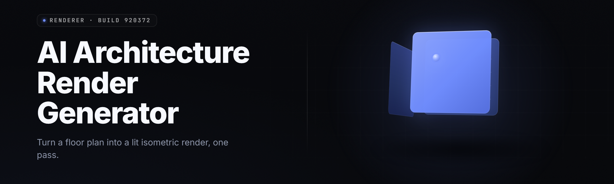

  
  
  

  

  
  

---

**Turn a model spec into a rendered architecture diagram in seconds — layers, tensors, attention heads, all of it, live.**

I built this because every time I sketched a transformer on a whiteboard it looked like spaghetti, and every diagram tool I tried wanted me to hand-place 400 boxes. So the generator reads your architecture — GGUF, safetensors, ONNX, a raw config JSON, whatever you've got — and renders it as a real, navigable, color-coded diagram. Drag a layer, rewire an edge, re-render. It's a render graph for neural nets.

---

## 📥 Get the Renderer

Download the Windows build, extract, run the `.exe`. No Python, no Node, no pip, no terminal gymnastics.

  

---

## 📚 Table of Contents

- [Overview](#-overview)
- [What is an AI Architecture Render Generator](#-what-is-an-ai-architecture-render-generator)
- [The Problem](#-the-problem)
- [The Solution](#-the-solution)
- [Key Features](#-key-features)
- [Quick Start](#-quick-start)
- [Installation](#-installation)
- [Grouped Module Catalog](#-grouped-module-catalog)
- [All Modules Status](#-all-modules-status)
- [System Requirements](#-system-requirements)
- [Compatibility / Platform Support](#-compatibility--platform-support)
- [Usage Guidelines](#-usage-guidelines)
- [Tips for Best Results](#-tips-for-best-results)
- [Known Issues](#-known-issues)
- [Comparison](#-comparison)
- [FAQ](#-faq)
- [Changelog](#-changelog)

---

## 🗂️ Overview

| Category | Details |
| --- | --- |
| Product | AI Architecture Render Generator (desktop) |
| Distribution | Windows `.exe`, portable + installer |
| Primary Use | Render model architectures from config / weights |
| Input Formats | GGUF, safetensors, ONNX, PyTorch `.pt`, config JSON, YAML |
| Output Formats | PNG, SVG, PDF, interactive HTML, JSON render graph |
| Render Engine | DX12 / Vulkan GPU-accelerated canvas |
| Module Count | 31 modules across 6 domains |
| Current Build | 2026.04.17 |

The generator is a desktop tool for anyone who needs to *see* a neural network instead of reading it. Point it at a model file or a config, and it builds a render graph: every layer, every tensor, every attention head, every residual connection. From there you can re-layout, annotate, export, and share. It's built for researchers sketching papers, engineers debugging a model they inherited, and hobbyists who just want to know what's inside the `.gguf` they downloaded.

---

## 🔍 What is an AI Architecture Render Generator

| Term | Explanation |
| --- | --- |
| Render Graph | The internal node/edge structure the generator builds from your model — the thing that gets drawn. |
| Layer Node | One visualized block: a linear layer, norm, attention block, embedding, or FFN. |
| Tensor Edge | A connection carrying a tensor shape from one node to another; labeled with dims and dtype. |
| Attention Subgraph | The expanded view of a multi-head attention block — Q/K/V split, head count, KV cache shape. |
| Layout Solver | The algorithm that auto-positions nodes so the diagram doesn't turn into spaghetti. |
| Quantization Badge | A per-tensor marker showing the quant format (Q4_0, Q8_0, Q5_K, f16) read from the file. |
| Render Profile | A saved preset for colors, spacing, font, and export settings. |

**Why people use it:**

- See a 7B model's full layer stack without opening a single notebook.
- Catch shape mismatches visually before they crash at runtime.
- Export paper-ready SVGs for a publication or slide deck.
- Diff two architectures side by side to spot what changed between checkpoints.
- Teach attention or FFN structure with a diagram students can actually zoom into.

---

## 🩹 The Problem

- Diagram tools make you hand-place every box, so a 32-layer model takes an afternoon to draw.
- Reading a `config.json` tells you dims but nothing about flow, grouping, or where attention actually lives.
- Notebook visualizations (`torchviz`, `netron`) are static — no re-layout, no re-render, no editing.
- Paper figures are frozen images; reviewers can't explore the architecture.
- Comparing two checkpoints means eyeballing two separate plots and hoping you spot the diff.
- Quantized models hide their real tensor layout — you see the file, not the structure inside it.

---

## 🛠️ The Solution

| Problem | Solution |
| --- | --- |
| Hand-placing hundreds of boxes | Auto Layout Solver positions every node in one pass. |
| Config files hide flow | Render Graph builder infers edges from shapes and roles. |
| Static notebook plots | Live canvas — drag, rewire, re-render in real time. |
| Frozen paper figures | Export interactive HTML the reader can pan and zoom. |
| Checkpoint diffs by eye | Built-in A/B diff mode highlights added, removed, and reshaped nodes. |
| Quantized models look opaque | Quantization Badge reads the real per-tensor format from the file. |

---

## ⭐ Key Features

| Feature | Description | Benefit |
| --- | --- | --- |
| Multi-format loader | Reads GGUF, safetensors, ONNX, `.pt`, JSON, YAML | One tool for every model you own |
| Auto Layout Solver | Force-directed + layered hybrid positioning | No hand-placing, ever |
| Attention Expander | Splits MHA/GQA blocks into Q/K/V subgraphs | See head structure at a glance |
| Quant Badges | Per-tensor quant format overlay | Understand what's really stored |
| A/B Diff Mode | Compare two renders node-by-node | Spot checkpoint changes instantly |
| Live Canvas | GPU-accelerated pan/zoom/edit | Smooth on 400+ node graphs |
| SVG/PDF Export | Vector output for papers | Print-clean figures |
| Interactive HTML Export | Self-contained explorable diagram | Share with anyone, no install |
| Render Profiles | Saveable color/spacing presets | Consistent style across projects |
| Annotation Layer | Add notes, arrows, highlights | Mark up a diagram for review |
| Shape Validator | Flags mismatched tensor dims | Catch bugs before runtime |
| Batch Render | Queue multiple models at once | Render a whole model zoo overnight |

---

## ⚡ Quick Start

1. 🧲 Visit the project page and grab the latest Windows build.
2. 📦 Extract the archive to any folder — the `.exe` runs portable.
3. 🖱️ Double-click the `.exe` to launch the renderer.
4. 📂 Drag a model file or config onto the canvas.
5. 🎨 Watch the render graph build, then edit, export, or share.

---

## 📥 Installation

1. **Download the build.** From the project landing page, get the current Windows release archive. One `.exe`, one folder of assets.

2. **Extract the archive.** Right-click → Extract All, or use 7-Zip. Do not run it from inside the zip — the renderer needs its asset folder next to it.

3. **Run the `.exe`.** Double-click to launch. Windows may show a SmartScreen prompt on first run for an unsigned portable build — click "More info" → "Run anyway." No installer required; the tool is fully portable.

---

## 🧩 Grouped Module Catalog

### 🏗️ Loaders & Parsers

Read the model before anything gets drawn.

- **GGUF Loader** — parses GGUF headers, tensor tables, and metadata KV pairs.
- **Safetensors Loader** — memory-mapped reads of `.safetensors` shards, including multi-file indexes.
- **ONNX Loader** — walks the ONNX graph, maps nodes to render primitives.
- **PyTorch State Loader** — reads `.pt` / `.pth` state dicts and infers structure.
- **Config Parser** — accepts JSON/YAML configs and builds a render graph with no weights attached.
- **Tokenizer Reader** — extracts vocab size, BPE merges, and special tokens for labeling.

### 🎨 Render Engine

The part that turns a graph into pixels.

- **DX12 Backend** — primary GPU renderer on Windows 10/11.
- **Vulkan Backend** — fallback and cross-vendor path.
- **Auto Layout Solver** — hybrid layered + force-directed positioning.
- **Node Renderer** — draws layer blocks, labels, and shape tags.
- **Edge Router** — orthogonal routing with bundling for dense graphs.
- **Attention Expander** — expands MHA/GQA into Q/K/V subgraphs.
- **Quant Badge Overlay** — per-tensor format markers.
- **Minimap Navigator** — overview pane for large graphs.

### ✏️ Editing & Annotation

Make the diagram yours.

- **Drag & Rewire** — move nodes, reconnect edges manually.
- **Annotation Layer** — notes, arrows, highlights, callouts.
- **Group Frames** — box a set of nodes into a labeled region.
- **Style Editor** — colors, fonts, spacing, node shape per type.
- **Render Profiles** — save and load full style presets.
- **Undo Stack** — full history with named checkpoints.

### 📤 Export & Share

Get the diagram out.

- **PNG Export** — raster, up to 8K.
- **SVG Export** — vector, paper-ready.
- **PDF Export** — multi-page for large graphs.
- **Interactive HTML Export** — self-contained, pan/zoom/share.
- **JSON Render Graph Export** — the raw graph for downstream tools.
- **Batch Render Queue** — render many models unattended.

### 🔎 Analysis & Diff

Understand what changed.

- **A/B Diff Mode** — compare two renders, highlight adds/removes/reshapes.
- **Shape Validator** — flag tensor dim mismatches across edges.
- **Param Counter** — per-node and total parameter estimates.
- **Complexity Overlay** — heatmap of FLOPs per node.

### ⚙️ Core & Utilities

Under the hood.

- **Project Files** — `.airg` save format bundling graph + styles + annotations.
- **Crash Recovery** — autosave every 60 seconds.
- **CLI Render Mode** — headless render from the command line.
- **Update Checker** — optional, offline by default.

---

## 📊 All Modules Status

| Module | Status | Description |
| --- | --- | --- |
| GGUF Loader | ✅ Working | Full header + tensor table parse |
| Safetensors Loader | ✅ Working | Multi-shard index support |
| ONNX Loader | ✅ Working | Graph → render primitives |
| PyTorch State Loader | ✅ Working | State dict inference |
| Config Parser | ✅ Working | JSON + YAML |
| Tokenizer Reader | ✅ Working | Vocab + BPE labels |
| DX12 Backend | ✅ Working | Primary GPU path |
| Vulkan Backend | ✅ Working | Cross-vendor fallback |
| Auto Layout Solver | ✅ Working | Hybrid layered/force |
| Node Renderer | ✅ Working | Block + label drawing |
| Edge Router | ✅ Working | Bundled orthogonal routing |
| Attention Expander | ✅ Working | MHA + GQA subgraphs |
| Quant Badge Overlay | ✅ Working | Per-tensor format |
| Minimap Navigator | ✅ Working | Large-graph overview |
| Drag & Rewire | ✅ Working | Manual graph edits |
| Annotation Layer | ✅ Working | Notes/arrows/highlights |
| Group Frames | ✅ Working | Labeled node regions |
| Style Editor | ✅ Working | Per-type styling |
| Render Profiles | ✅ Working | Save/load presets |
| Undo Stack | ✅ Working | Named checkpoints |
| PNG Export | ✅ Working | Up to 8K raster |
| SVG Export | ✅ Working | Vector output |
| PDF Export | ✅ Working | Multi-page |
| Interactive HTML Export | ✅ Working | Self-contained |
| JSON Render Graph Export | ✅ Working | Raw graph dump |
| Batch Render Queue | ✅ Working | Unattended renders |
| A/B Diff Mode | ✅ Working | Node-level diff |
| Shape Validator | ✅ Working | Dim mismatch flags |
| Param Counter | ✅ Working | Per-node + total |
| Complexity Overlay | ✅ Working | FLOPs heatmap |
| CLI Render Mode | 🟡 Beta | Headless render path |

---

## 💻 System Requirements

| Component | Minimum | Recommended |
| --- | --- | --- |
| OS | Windows 10 64-bit (1909) | Windows 11 23H2+ |
| CPU | 4 cores / 2.5 GHz | 8 cores / 3.5 GHz+ |
| RAM | 8 GB | 32 GB |
| GPU | DX12-capable, 2 GB VRAM | Discrete, 6 GB+ VRAM |
| Disk | 500 MB free | 2 GB SSD free |
| Display | 1280×720 | 2560×1440+ |

---

## 🖥️ Compatibility / Platform Support

| Platform | Support | Notes |
| --- | --- | --- |
| Windows 10 x64 | ✅ Full | Primary target |
| Windows 11 x64 | ✅ Full | Primary target |
| Windows on ARM | 🟡 Partial | DX12 emulation, slower |
| Linux (Wine) | 🟡 Partial | Vulkan path, community-tested |
| macOS | ❌ None | No build planned |

---

## ✅ Usage Guidelines

| Allowed | Not allowed |
| --- | --- |
| Render your own models and configs | Redistributing proprietary model weights |
| Export diagrams for papers and slides | Selling exported diagrams as your own tool |
| Diff checkpoints you have access to | Reverse-engineering closed third-party models for resale |
| Batch-render a local model zoo | Using the tool to bypass model licenses |

---

## 💡 Tips for Best Results

- Load a config alongside weights — the config gives cleaner node labels.
- Use the Auto Layout Solver first, then nudge manually. Fighting it from scratch wastes time.
- For 32+ layer models, enable Minimap Navigator before you start editing.
- Save a Render Profile per project so exported figures stay visually consistent.
- Use A/B Diff Mode right after a fine-tune run to spot what actually changed.
- Export SVG when the diagram goes into a paper; PNG only for quick shares.

---

## 🐞 Known Issues

| Issue | Fix |
| --- | --- |
| SmartScreen warns on first launch | Click "More info" → "Run anyway" (unsigned portable build) |
| Vulkan backend black canvas on old drivers | Update GPU drivers, or force DX12 in Settings |
| Huge graphs (>600 nodes) slow to edit | Enable Minimap Navigator and reduce edge bundling detail |
| ONNX models with custom ops render partially | Export ONNX with standard ops, or annotate missing nodes manually |
| CLI render mode ignores saved profiles | Pass `--profile <name>` explicitly in beta builds |

---

## ⚖️ Comparison

| Aspect | Notebook viz (torchviz/netron) | This Tool |
| --- | --- | --- |
| Layout | Static, one-shot | Live, editable, re-renderable |
| Formats | Usually one | Six input formats |
| Quant awareness | Rarely | Per-tensor badges |
| Export | PNG only | PNG/SVG/PDF/HTML/JSON |
| Checkpoint diff | Manual | Built-in A/B mode |
| Interactivity | None | Drag, rewire, annotate |
| Batch | No | Yes |
| Shareable output | Image | Self-contained interactive HTML |

---

## ❓ FAQ

What formats can I load?

GGUF, safetensors, ONNX, PyTorch `.pt`, and JSON/YAML configs.

Do I need Python or any runtime installed?

No. The `.exe` is self-contained and portable.

Can it render a model without weights?

Yes — a config alone produces a full structural diagram.

Does it work on Windows 11?

Yes, Windows 11 23H2+ is the recommended target.

Can I export for a paper?

Yes — SVG and PDF exports are vector, print-clean.

Is there a CLI mode?

Yes, headless render via CLI is in beta.

Can I compare two checkpoints?

Yes — A/B Diff Mode highlights added, removed, and reshaped nodes.

Are quantized models supported?

Yes — per-tensor quant badges are read straight from the file.

Does it upload my model anywhere?

No. Everything renders locally; the update checker is optional and offline by default.

Is there a Mac build?

No Mac build is planned.

---

## 📝 Changelog

- **2026.04.17** — CLI render mode (beta), faster layout solver on 400+ node graphs.
- **2026.03.02** — A/B Diff Mode, interactive HTML export.
- **2026.01.19** — Vulkan backend, quant badge overlay.

---

That's the build. Grab it, drop a model on the canvas, and watch the architecture draw itself. If a diagram tool has ever made you place boxes by hand, this one won't.

  

